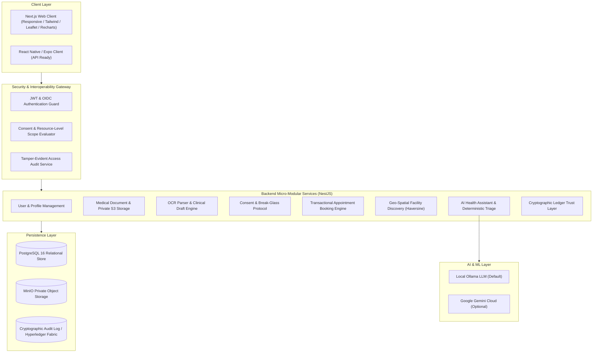

# HealthSync Architecture Documentation

## 1. System Vision & Interoperability
HealthSync is designed to address the deep fragmentation of modern healthcare records by delivering a secure, patient-controlled interoperability platform. The core architecture guarantees that no healthcare provider can access medical documents without an explicit, active, and category-scoped consent grant issued by the patient, while retaining a rigorously audited break-glass emergency override for life-critical resuscitation scenarios.

---

## 2. High-Level Architecture

---

## 3. Core Architectural Modules

### A. Security & Consent-Based Record Sharing
- **Zero-Trust Patient Boundaries:** Patient identities are segregated from provider profiles. No clinician has universal or default access to records.
- **Granular Category Scoping:** Patients permit specific subsets: `LAB_REPORT`, `PRESCRIPTION`, `IMAGING`, `CONSULTATION_NOTE`, or `DISCHARGE_SUMMARY`.
- **Break-Glass Emergency Protocol:** Verified emergency doctors can override consent in life-critical situations. The action produces high-priority alerts to the patient and administrators and is logged in the permanent audit ledger.

### B. Document Management & Integrity
- **Private Storage:** All raw medical files are stored outside the public web server root in MinIO/S3 private buckets.
- **Short-Lived Signed URLs:** Access tokens and pre-signed download URLs expire after 5-10 minutes.
- **Cryptographic Tamper-Evident Hashing:** Each uploaded document is hashed with SHA-256 upon reception and anchored to the ledger.

### C. AI Health Assistant & Deterministic Red-Flag Triage
- **Deterministic Pre-LLM Evaluation:** Analyzes user input for acute coronary syndrome, stroke FAST symptoms, severe dyspnea, anaphylaxis, and self-harm before any LLM inference.
- **Multi-Provider Adapter:** Connects to local Ollama (llama3.2) by default or Google Gemini API.
- **Safety Disclaimers & No-Prescribing Guardrail:** Explicitly prevents unauthorized medication alteration or definitive disease diagnosis.

### D. Transactional Appointment Scheduling
- **Concurrency Protection:** Uses serializable database transactions (`prisma.$transaction`) to verify slot availability and reserve slots atomically, preventing race conditions and double-booking.
