# HealthSync Database Schema & Data Dictionary

HealthSync uses PostgreSQL with Prisma ORM. All entities use UUID primary keys, explicit relational constraints, indexed foreign keys, and audit timestamps.

## 1. Entity-Relationship Diagram (30 Entities)

```mermaid
erDiagram
    User ||--o| PatientProfile : "has"
    User ||--o| DoctorProfile : "has"
    User ||--o{ OrganizationMembership : "member"
    HealthcareOrganization ||--o{ HealthcareFacility : "owns"
    HealthcareOrganization ||--o{ Laboratory : "owns"
    DoctorProfile ||--o{ ProviderSpecialty : "has"
    DoctorProfile ||--o{ ProviderVerification : "certified by"
    PatientProfile ||--o{ MedicalRecord : "owns"
    PatientProfile ||--o{ MedicalDocument : "uploads"
    MedicalDocument ||--o| OCRJob : "parsed by"
    MedicalDocument ||--o{ DocumentVersion : "versioned as"
    MedicalDocument ||--o| MedicalReport : "structured as"
    PatientProfile ||--o{ Prescription : "receives"
    DoctorProfile ||--o{ Prescription : "issues"
    Prescription ||--o{ Medication : "contains"
    PatientProfile ||--o{ Allergy : "diagnosed"
    PatientProfile ||--o{ Condition : "diagnosed"
    PatientProfile ||--o{ Encounter : "attends"
    DoctorProfile ||--o{ Encounter : "conducts"
    PatientProfile ||--o{ ConsentGrant : "grants"
    DoctorProfile ||--o{ ConsentGrant : "receives"
    PatientProfile ||--o{ AccessRequest : "reviews"
    DoctorProfile ||--o{ AccessRequest : "submits"
    User ||--o{ AccessAuditEvent : "actor"
    PatientProfile ||--o{ AccessAuditEvent : "subject"
    HealthcareFacility ||--o{ AppointmentSlot : "schedules"
    DoctorProfile ||--o{ AppointmentSlot : "attends"
    AppointmentSlot ||--o| Appointment : "booked"
    PatientProfile ||--o{ Appointment : "books"
    User ||--o{ AIConversation : "creates"
    AIConversation ||--o{ AIMessage : "contains"
    PatientProfile ||--o{ EmergencyContact : "designates"
    DoctorProfile ||--o{ DoctorFacilityAffiliation : "practices at"
    HealthcareFacility ||--o{ DoctorFacilityAffiliation : "hosts"
    User ||--o{ Notification : "receives"
    User ||--o{ DataExportRequest : "requests"
```

---

## 2. Core Entities Data Dictionary

| Table | Purpose | Primary Key | Key Foreign Keys & Indexes |
|---|---|---|---|
| `User` | Authentication identity & role | `id` (UUID) | Unique `email`, indexed `role` |
| `PatientProfile` | Patient demographics & clinical baseline | `id` (UUID) | Unique `userId`, indexed `[city, state]` |
| `DoctorProfile` | Verified medical practitioner profile | `id` (UUID) | Unique `userId`, unique `licenseNumber` |
| `HealthcareOrganization` | Hospital network / corporate entity | `id` (UUID) | Unique `code`, unique `licenseNumber` |
| `OrganizationMembership` | Clinician/staff affiliation to organization | `id` (UUID) | Unique `[userId, organizationId]` |
| `MedicalDocument` | File metadata, hash & storage key | `id` (UUID) | Indexed `[patientId, category]`, indexed `sha256Hash` |
| `OCRJob` | OCR extraction job state & raw text | `id` (UUID) | Unique `documentId` |
| `MedicalReport` | Structured lab metrics extracted from document | `id` (UUID) | `documentId` |
| `Prescription` | Digital prescription record | `id` (UUID) | Indexed `patientId`, indexed `doctorId` |
| `Medication` | Individual medication dosage and instructions | `id` (UUID) | `prescriptionId` |
| `ConsentGrant` | Scoped time-bound access permission | `id` (UUID) | Indexed `[patientId, doctorId, status]` |
| `AccessRequest` | Provider record access request | `id` (UUID) | Indexed `[patientId, doctorId, status]` |
| `AccessAuditEvent` | Immutable security access trail | `id` (UUID) | Indexed `actorUserId`, indexed `targetPatientId` |
| `AppointmentSlot` | Doctor clinical availability slot | `id` (UUID) | Indexed `[doctorId, startTime]`, indexed `[facilityId, startTime]` |
| `Appointment` | Confirmed patient booking with unique ref | `id` (UUID) | Unique `slotId`, unique `bookingReference` |
| `DoctorFacilityAffiliation` | Doctor practice affiliation at a facility | `id` (UUID) | Indexed `[doctorId, facilityId]` |
| `AIConversation` | Chat session thread | `id` (UUID) | Indexed `userId` |
| `AIMessage` | Chat message with triage urgency metadata | `id` (UUID) | Indexed `[conversationId, createdAt]` |

